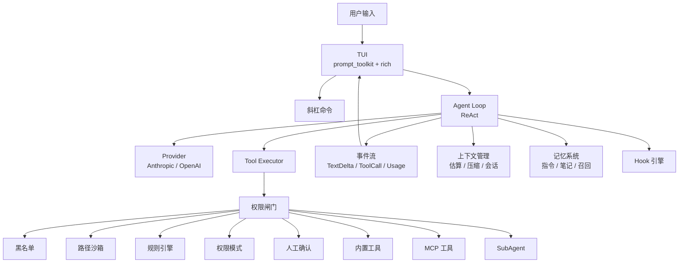

# MewCode 🐱

> 用 Python 从零实现的终端 AI 编程助手 —— 自研 Agent Loop、工具系统、五层权限、MCP、记忆与 SubAgent。

[](https://www.python.org/)
[](https://github.com/YOUR_GITHUB_USER/mewcode/actions/workflows/ci.yml)
[](#测试)
[](LICENSE)
[](https://codespaces.new/YOUR_GITHUB_USER/mewcode)

MewCode 是一个类似 Claude Code 的终端编程 Agent：在终端里用自然语言描述任务，它会读取代码、搜索文件、执行命令、修改代码，并在每一步有副作用的操作前向你确认。项目不依赖 LangChain 等 Agent 框架，核心循环、工具协议、权限闸门、上下文管理、MCP 客户端与记忆系统全部从零实现。

---

## 演示


> 一次真实会话：写文件 → 权限确认 → 执行 → 总结。

<details>
<summary>展开查看交互示例</summary>

```text
❯ 写一个 fizzbuzz.py，打印 1 到 15 的 FizzBuzz，然后运行它

🐱 MewCode
第 1 轮
🔧 write_file  {"path": "fizzbuzz.py", "content": "..."}

╭──────────────────────── ⚠ 需要权限确认 ────────────────────────╮
│ 工具: write_file                                                │
│ 原因: 默认模式：有副作用的工具需要人工确认                      │
╰─────────────────────────────────────────────────────────────────╯
  [y] 本次允许  [s] 本会话允许  [a] 永久允许  [n] 拒绝 >

🔧 run_command  {"command": "python3 fizzbuzz.py"}
1
2
Fizz
4
Buzz
...

已完成：fizzbuzz.py 写好了，运行输出符合预期。
```

</details>

---

## 功能特性

| 模块 | 能力 |
|---|---|
| **Agent 内核** | 流式 ReAct 循环、多轮工具调用、工具结果回灌、中断与恢复、token 用量统计 |
| **工具系统** | 7 个内置工具：`read_file` / `write_file` / `edit_file` / `run_command` / `grep_code` / `find_files` / `agent`；工具注册表统一 schema 与执行入口 |
| **五层权限** | 黑名单硬拦 → 路径沙箱 → 可配置规则 → 权限模式兜底 → 人在回路确认；拒绝原因回灌模型，循环不中断 |
| **双协议 Provider** | Anthropic Messages 与 OpenAI Chat Completions 双协议，流式 SSE、Anthropic extended thinking、OpenAI 兼容服务的 `thinking` 参数透传、`context_window` 配置化 |
| **MCP 客户端** | stdio 子进程与 Streamable HTTP 两种传输；启动时 `tools/list` 动态发现工具；单个 Server 握手失败自动隔离 |
| **上下文管理** | 工具结果超阈值落盘只留预览；历史逼近窗口上限时 LLM 结构化摘要兜底；连续失败 3 次熔断 |
| **记忆系统** | 三层指令文件、JSONL 会话存档与 `--resume`、LLM 异步笔记、索引注入与 `recall_memory` 渐进式披露 |
| **技能系统** | `SKILL.md` + frontmatter；内置/用户/项目三级发现；`commit` / `review` / `test` 内置技能；独立会话执行 |
| **Hook 系统** | 10 个生命周期事件；精确/反向/正则/glob 条件组合；shell / 注入提示词 / HTTP / 子 Agent 四种动作；Hook 失败不阻断主流程 |
| **SubAgent** | 定义式角色 + Fork 式继承两条路径；独立上下文/权限/工具集；后台任务与 `/tasks` 管理；三层工具过滤防无限嵌套 |
| **终端 UI** | prompt_toolkit + rich；流式 Markdown 渲染、输入补全、双击 Ctrl+C 退出、计划模式、权限确认面板 |
| **斜杠命令** | `/help` `/compact` `/clear` `/plan` `/do` `/session` `/memory` `/permission` `/status` `/resume` `/skill` `/tasks` |

---

## 架构



**一次请求的路径**：TUI 收集输入 → Agent Loop 组装系统提示与历史 → Provider 流式返回文本/工具调用 → 有工具调用则交给执行器，先过权限闸门再执行，结果回灌 → 循环直到模型不再调用工具 → TUI 渲染最终回复并持久化会话。

---

## 快速开始

### 1. 安装

```bash
git clone https://github.com/YOUR_GITHUB_USER/mewcode.git
cd mewcode

python3 -m venv .venv
source .venv/bin/activate        # Windows: .venv\Scripts\activate
pip install -e ".[dev]"
```

要求 Python 3.10+。

### 2. 配置模型

MewCode 支持 Anthropic 与 OpenAI 兼容协议。复制示例配置并填入自己的 key：

```bash
mkdir -p ~/.mewcode
cp config.example.yaml ~/.mewcode/config.yaml
chmod 600 ~/.mewcode/config.yaml
```

最小配置（以 DeepSeek 为例）：

```yaml
providers:
  - name: deepseek
    protocol: openai
    model: deepseek-chat
    base_url: https://api.deepseek.com
    api_key: sk-your-key          # 不要提交到 git
    context_window: 65536         # 可选，缺省 200000
```

也可以直接用 Anthropic：

```yaml
providers:
  - name: claude
    protocol: anthropic
    model: claude-sonnet-4-5
    base_url: https://api.anthropic.com
    api_key: sk-ant-your-key
    thinking: true                # 可选，启用扩展思考
```

多份 provider 配置可以用 `--profile` 切换：

```bash
mewcode --profile deepseek
mewcode --config /path/to/config.yaml
```

### 3. 启动

```bash
mewcode
```

```text
╭──────────────────────── MewCode v0.1.0 ────────────────────────╮
│ 配置: deepseek（协议 openai）                                   │
│ 模型: deepseek-chat                                             │
│ 权限模式: 默认（default，/permission 切换）                     │
│ 输入 /help 查看可用命令。                                       │
╰─────────────────────────────────────────────────────────────────╯
❯
```

恢复上一次会话：

```bash
mewcode --resume            # 恢复最近一个会话
mewcode --resume <session_id>
```

### 4. Docker（可选）

```bash
docker compose build
docker compose run --rm mewcode
```

`compose.yaml` 会把 `runtime/user` 挂到容器内 `~/.mewcode`、`runtime/workspace` 挂到 `/workspace`。首次使用前把配置文件放到 `runtime/user/config.yaml`。

### 5. 在线体验（GitHub Codespaces）

点击仓库顶部的 **Open in GitHub Codespaces** 徽章，GitHub 会在云端启动一个隔离的浏览器 IDE。首次启动会自动安装依赖，然后在终端里执行：

```bash
bash scripts/setup-codespace-config.sh   # 按提示输入你自己的 API key
mewcode
```

Codespaces 使用你自己的 API key 与额度，不会消耗项目作者的额度。

---

## 使用示例

### 自然语言任务

```text
❯ 找出这个项目里所有 TODO，按文件分组，并挑一个最容易修的修掉

🐱 MewCode
第 1 轮
🔧 grep_code  {"pattern": "TODO", "path": "."}
...
🔧 read_file  {"path": "mewcode/tools/base.py"}
...
🔧 edit_file  {"path": "...", "old_text": "...", "new_text": "..."}

╭──────────────────────── ⚠ 需要权限确认 ────────────────────────╮
│ 工具: edit_file                                                 │
│ 原因: 默认模式：有副作用的工具需要人工确认                      │
╰─────────────────────────────────────────────────────────────────╯
  [y] 本次允许  [s] 本会话允许  [a] 永久允许  [n] 拒绝 >
```

### 权限模式

| 模式 | 行为 |
|---|---|
| `strict` | 只读工具也需要确认 |
| `default` | 只读放行，有副作用的工具询问（推荐） |
| `accept` | 未命中规则的操作一律放行；黑名单/沙箱/deny 规则仍生效 |

用 `/permission` 循环切换，或在配置文件的 `permissions` 段声明规则。

### 计划模式

```text
❯ /plan
已进入计划模式：只有只读工具可用

❯ 分析一下这个项目的权限系统是怎么设计的
...

❯ /do
已退出计划模式
```

### 常用斜杠命令

| 命令 | 作用 |
|---|---|
| `/help` | 帮助与命令列表 |
| `/compact` | 立即压缩上下文 |
| `/clear` | 清空对话，开始新会话 |
| `/plan` / `/do` | 进入 / 退出计划模式 |
| `/session` | 查看当前会话信息 |
| `/memory` | 查看记忆系统状态 |
| `/permission` | 切换权限档位 |
| `/status` | 系统状态与 token 用量 |
| `/resume` | 列出最近会话并恢复 |
| `/skill` | 列出 / 使用技能 |
| `/tasks` | 查看后台子 Agent 任务 |
| `/exit` | 退出 |

---

## 配置进阶

### MCP Server

stdin/stdout 子进程：

```yaml
mcp_servers:
  demo:
    command: python
    args: [scripts/mock_mcp_server.py]
    env:
      MOCK_PAGE_SIZE: "${MOCK_PAGE_SIZE}"   # 支持 ${VAR} 展开
```

Streamable HTTP：

```yaml
mcp_servers:
  context7:
    url: https://mcp.context7.com/mcp
    headers:
      Authorization: "Bearer ${CONTEXT7_TOKEN}"
```

用户级配置（`~/.mewcode/config.yaml`）与项目级配置（`.mewcode/config.yaml`）按键合并，同名条目整条覆盖。MewCode 在启动握手时调用 `tools/list` 动态拉取工具，单个 Server 失败会隔离跳过，不影响其他工具。

### Hook

```yaml
hooks:
  - event: tool_before
    if:
      all:
        - field: tool
          pattern: run_command
        - field: args.command
          pattern: /rm -rf/
    action:
      type: command
      run: 'echo "危险删除已被 Hook 拦截"; exit 1'
```

- 事件：`session_start` / `session_end` / `round_start` / `round_end` / `user_message` / `assistant_message` / `tool_before` / `tool_after` / `startup` / `shutdown`
- 条件：精确、反向、正则、glob；`all` / `any` 组合
- 动作：`command` / `inject` / `http` / `agent`
- `tool_before` 上的非零退出或非 2xx 会作为拒绝原因回灌给模型

### 子 Agent 角色

在 `.mewcode/agents/` 下放一个 Markdown + frontmatter 即可定义角色：

```markdown
---
name: code-reviewer
description: 代码审查：找 bug 与简化机会
tools: [read_file, grep_code, find_files, run_command]
permission: accept
---

你是 MewCode 的代码审查子 Agent。按严重程度输出发现列表。
```

主 Agent 通过 `agent` 工具调用：`defined` 角色使用独立空白上下文，`fork` 继承父对话并利用 prompt cache。

---

## 项目结构

```text
mewcode/
├── mewcode/
│   ├── agent/          # ReAct 循环、事件流、工具执行器
│   ├── agents/         # SubAgent 角色发现、管理器、上下文隔离
│   ├── commands/       # 斜杠命令注册与分发
│   ├── context/        # token 估算、上下文压缩、会话存储
│   ├── hooks/          # 生命周期事件、条件匹配、四种动作
│   ├── mcp/            # MCP 配置、协议、stdio/HTTP 传输、工具适配
│   ├── memory/         # 指令文件、会话存档、笔记、回忆工具
│   ├── permissions/    # 黑名单、沙箱、规则、权限闸门
│   ├── prompt/         # 系统提示模块化组装
│   ├── provider/       # Anthropic / OpenAI 协议与流式解析
│   ├── skills/         # 技能发现、加载、执行
│   ├── tools/          # 内置工具与注册表
│   └── tui/            # prompt_toolkit + rich 终端界面
├── tests/              # 62 个测试文件，745 个用例
├── docs/ch01..ch17/    # 每章 spec / plan / task / checklist
├── scripts/            # 演示与辅助脚本
├── config.example.yaml
├── Dockerfile
├── compose.yaml
└── pyproject.toml
```

---

## 测试

```bash
pip install -e ".[dev]"
pytest -q
```

```text
745 passed in 19.19s
```

测试覆盖 Agent 循环、工具执行、权限五层、MCP 协议与传输、上下文压缩、记忆召回、Hook 条件与动作、SubAgent 生命周期、TUI 关键路径等。

## 设计文档

项目采用 spec-driven 开发：每个功能先写四份文档，再实现与验收。

```text
docs/chXX/
├── spec.md        # 做什么：背景、目标、功能需求
├── plan.md        # 怎么做：架构决策、模块划分
├── task.md        # 按什么顺序做
└── checklist.md   # 做对了没：行为级验收项
```

17 章覆盖：TUI 对话 → 工具系统 → Agent Loop → 系统提示 → 五层权限 → MCP → 上下文管理 → 记忆 → 斜杠命令 → 技能 → Hook → SubAgent → 记忆渐进式披露。

## 工程数据

| 指标 | 数值 |
|---|---|
| 核心 Python 代码 | 9,809 行 |
| 测试代码 | 10,736 行 |
| 测试用例 | 745 个，全部通过 |
| 设计文档 | 17 章、68 个 Markdown 文件 |
| 内置工具 | 7 个 |
| Hook 事件 | 10 个 |

## License

[MIT](LICENSE)
